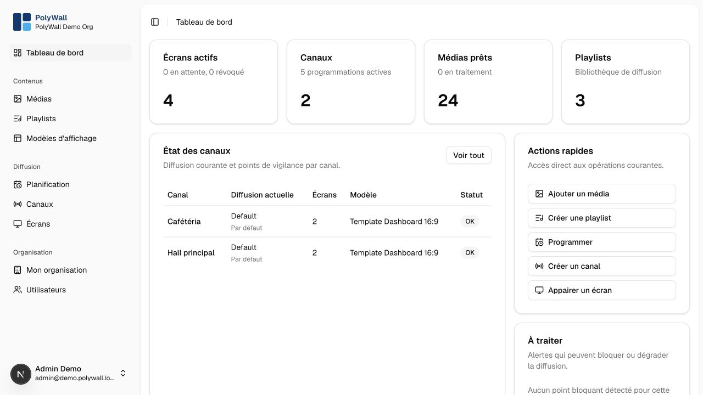

# PolyWall

PolyWall is a self-hosted digital-signage platform for composing, scheduling, and displaying media across a fleet of browser-based screens.



The administration interface is currently available in French. The repository and its technical documentation are in English.

## Highlights

- image, video, PDF, and presentation library
- drag-and-drop playlists
- default, recurring, and event-based schedules
- independent channels and secure screen pairing
- full-screen and multi-zone display templates
- clock, weather, RSS, and GTFS/GTFS-RT transit widgets
- organization-level data isolation and role-based permissions
- asynchronous media processing backed by S3-compatible storage.

## Documentation

Read the [documentation website](https://horizon-nth.github.io/PolyWall/).

The complete documentation lives in [`docs/`](docs/index.md):

- [user guide](docs/user-guide/index.md)
- [roles and administration](docs/administration/roles-and-permissions.md)
- [deployment and configuration](docs/operations/deployment.md)
- [technical architecture](docs/technical/architecture.md)
- [local development setup](docs/development/local-setup.md).

Preview the documentation site locally with:

```bash
python3.13 -m venv .venv-docs
source .venv-docs/bin/activate
python -m pip install -r requirements-docs.txt
python -m mkdocs serve
```

The documentation is then available at `http://127.0.0.1:8000`. Reuse the environment later with `source .venv-docs/bin/activate` before running MkDocs.

## Requirements

- Node.js compatible with Next.js 16
- pnpm 10.32.1
- Python 3.13 for the documentation site
- Docker for the complete local environment
- `ffmpeg`, Poppler, and LibreOffice when running the media worker outside Docker

## Quick start

```bash
pnpm install
cp .env.example .env
pnpm docker:dev
```

The development stack starts the application, PostgreSQL, Redis, MinIO, and the media worker.

Initialize the database on first launch:

```bash
pnpm exec prisma migrate dev
pnpm db:seed
```

The seed creates demo organizations, users, templates, channels, screens, widgets, media, playlists, and schedules. See [`prisma/SEED.md`](prisma/SEED.md) for the generated accounts and optional demo assets.

## Quality checks

```bash
pnpm dev
pnpm test
pnpm typecheck
pnpm lint
pnpm e2e
```

## Display client

The screen client is available at `/display`. A device creates a local identifier, submits a temporary pairing code, and waits for an administrator to approve it and assign a channel.

## Media worker

The worker analyzes uploaded files, generates thumbnails, and renders PDFs or presentations into display-ready images.

```bash
pnpm worker:media
```

In Docker, `Dockerfile.worker` installs the native dependencies required for videos, PDFs, and presentations.

## Contributing and security

Contributions are welcome through issues and pull requests. Read [`CONTRIBUTING.md`](CONTRIBUTING.md) before making a change. Please report vulnerabilities according to [`SECURITY.md`](SECURITY.md), not in a public issue.

## License

PolyWall is available under the [MIT License](LICENSE).
