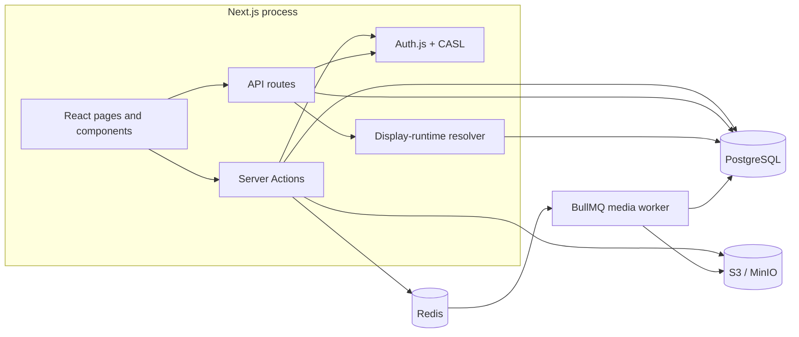
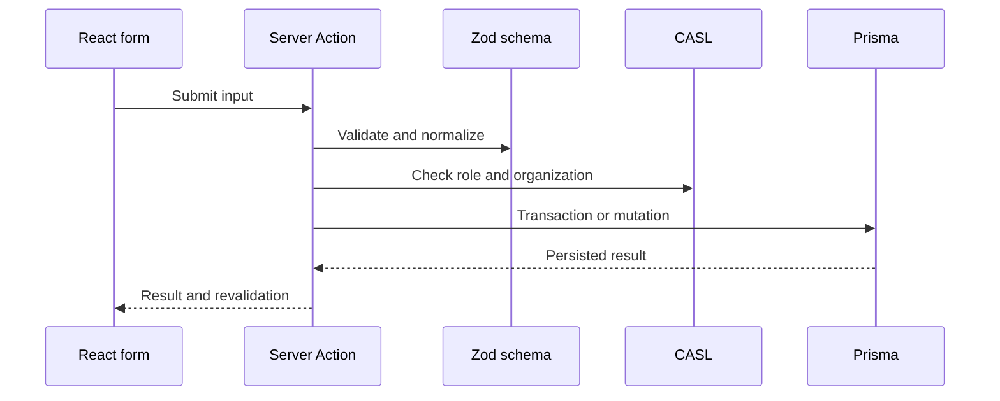

# Technical architecture

PolyWall is a TypeScript and Next.js application containing the administration UI, internal APIs, and display player. A separate worker handles expensive media operations.

## Responsibilities

- `src/app`: Next.js pages and API entry points
- `src/components`: administration UI and display player
- `src/actions`: server-side mutations and access checks
- `src/lib`: domain rules and integrations
- `src/schemas`: Zod input validation
- `prisma`: relational schema and migrations
- `src/workers`: asynchronous media processing.

## Mutation path

The modular monolith keeps types, transactions, and deployment cohesive. Media processing is separated because it depends on resource-heavy native binaries and must scale independently.
