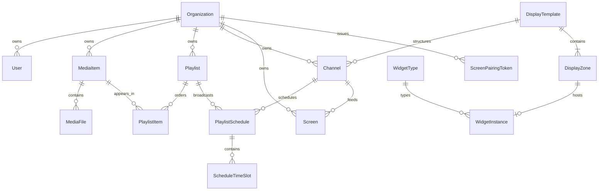

# Data model

The Prisma schema is the source of truth for the relational model. Most domain entities belong to an organization, providing logical tenant separation.

Playlist, channel, and screen names are unique within an organization. user email addresses are globally unique. Display templates with an `organizationId` are local, while templates with a null owner are global.

`MediaItem` stores editorial metadata and duration. `MediaFile` represents originals, thumbnails, and rendered variants. `PlaylistSchedule` associates a playlist and channel. `ScheduleTimeSlot` stores recurring weekday intervals.

Many tenant-owned relationships cascade on deletion. Shared relationships use `Restrict` or `SetNull` where appropriate. Every schema change must review deletion consequences explicitly.
