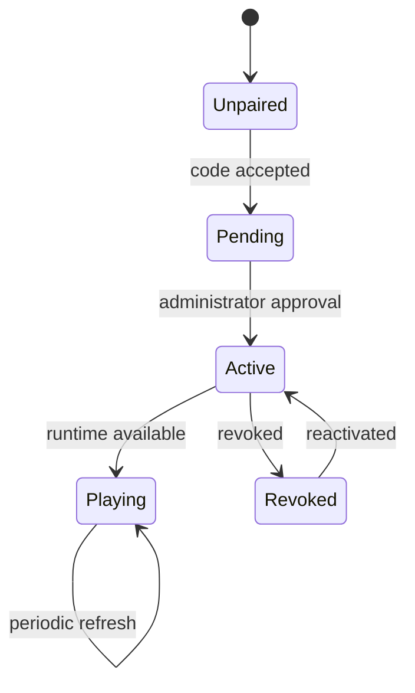

# Display runtime

The `/display` player identifies its device, retrieves pairing state, and requests a server-computed broadcast snapshot.

## Runtime resolution

1. Authenticate the device identifier.
2. Confirm that the paired screen is active.
3. Load its channel and timezone.
4. Calculate channel-local time.
5. Select the active event, recurrence, or default schedule.
6. Load the playlist, ready files, template, zones, and widgets.
7. Generate short-lived media URLs.
8. Return a snapshot consumed by the player.

Event schedules take priority over recurring schedules, which take priority over the default. Resolution considers activation, date bounds, weekday, time range, and channel timezone.

The runtime cache and snapshot utilities reduce repeated work, but full offline playback is not guaranteed. Screens must periodically reach the application and renew signed media URLs. Pairing and runtime routes validate input, enforce screen status, and apply rate limits.
