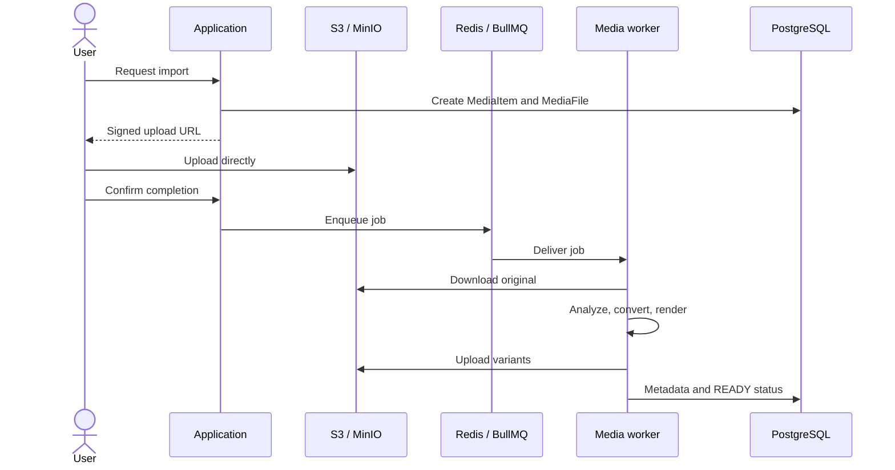

# Media processing

Upload and conversion are separated from web requests so long-running operations do not block the user.

- **Images:** Sharp extracts metadata and creates thumbnails.
- **Videos:** FFmpeg/ffprobe extracts metadata, duration, and a preview frame.
- **PDFs:** Poppler renders pages.
- **PPT/PPTX:** LibreOffice converts to PDF, then Poppler renders slides.

The state machine is `AWAITING_UPLOAD` → `UPLOADED` → `PROCESSING` → `READY`, with `FAILED` on error. Processing versions distinguish current outputs, and storage keys include tenant and resource identifiers to prevent collisions.

Multiple BullMQ workers can share Redis, PostgreSQL, and storage. Tune concurrency to available memory and temporary disk space. LibreOffice and FFmpeg are significantly heavier than image thumbnails.
