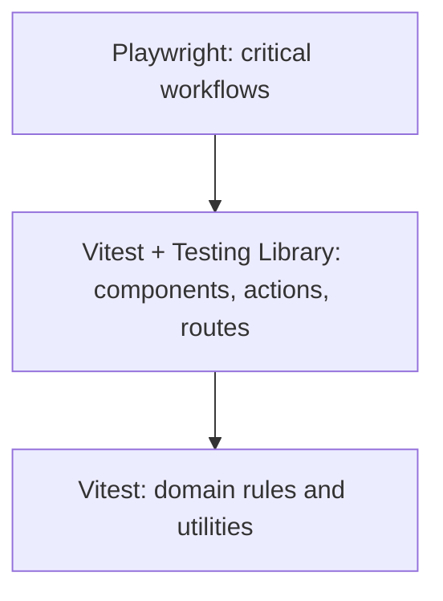

# Testing and quality

The project combines unit, component, route, and end-to-end tests.



```bash
pnpm test
pnpm coverage
pnpm typecheck
pnpm lint
pnpm e2e
pnpm build
```

Playwright scenarios cover authentication, role navigation, organizations, users, administrators, media, playlists, templates, channels, schedules, and screens. Unit and integration tests target schedule selection, display runtime, route security, widget services, storage keys, and media processing.

Cross-cutting mocks live in `src/test/mocks`, shared builders in `src/test/fixtures/builders.ts`, and test initialization in `src/test/setup.ts`. Keep scenario-specific domain mocks close to the test that uses them.

Before contributing, run type checking, linting, and affected tests. Changes to authentication, permissions, scheduling, or display playback should include regression coverage and relevant E2E scenarios.
