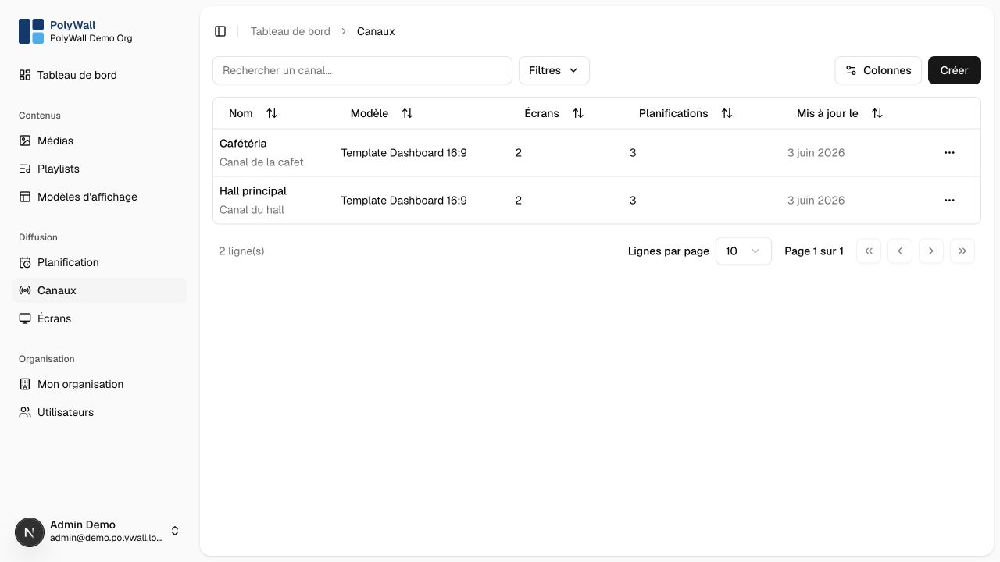

# Channels

A channel is an independent broadcast stream. It connects one display template, a timezone, schedules, and one or more
screens.

## Create a channel

1. Open **Canaux** and select **Créer**.
2. Enter a unique name and optional description.
3. Choose a display template.
4. Select the timezone used to evaluate schedules.
5. Save the channel.

The channel page shows its template, timezone, assigned screens, and current broadcast preview.

<!-- @formatter:off -->
!!! warning
    Preview after changing a playlist, schedule, or template, then verify at least one physical screen. Codec support and
    performance can differ across embedded browsers.
<!-- @formatter:on -->

Reassign screens and review schedules before deleting a channel.
