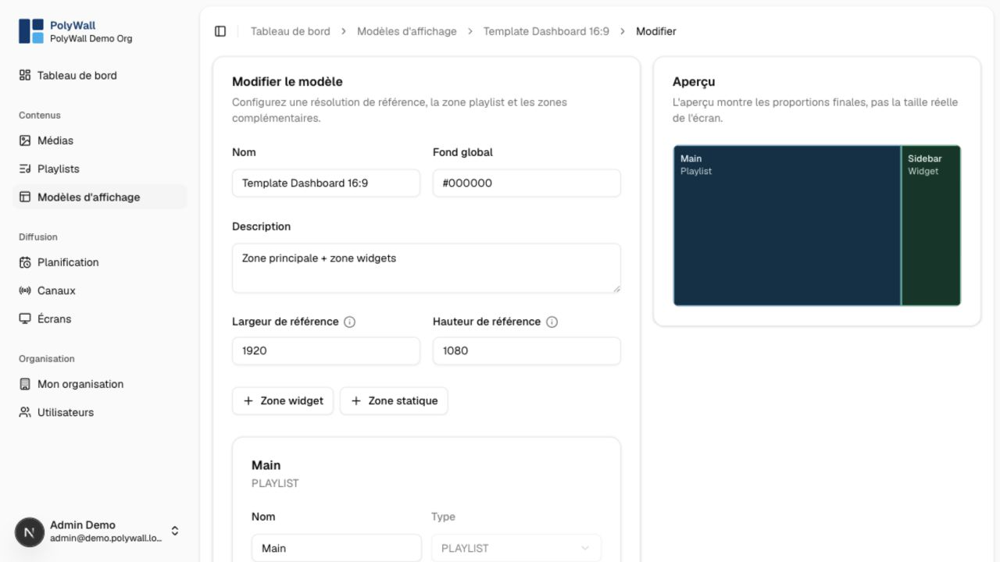

# Display templates

A display template defines a reference resolution, background, and non-overlapping content zones. The player scales that reference layout to the physical screen.

## Zone types

- **Playlist** displays the channel's currently selected playlist.
- **Static media** always displays a chosen asset.
- **Widget** renders a configured clock, weather, RSS, or transit view.

## Design workflow

1. Create a template and choose its reference width and height.
2. Add, move, and resize zones in the editor.
3. Select the content type and configuration for each zone.
4. Check that zones do not overlap unintentionally.
5. Save and preview on the target aspect ratio.

Changing a channel's template updates every screen assigned to that channel without changing its schedules.

The detailed zone controls define the widget type, position, dimensions, stacking order, and widget-specific settings.

