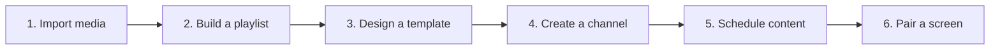

# User guide

PolyWall turns source files into scheduled content displayed by browser-based screens.

The interface is currently in French. Documentation uses English names followed by the exact French label when that helps locate an action.

## Concepts

- **Media** is an uploaded image, video, PDF, or presentation.
- **Playlist** is an ordered loop of media items.
- **Display template** defines a reference resolution and one or more zones.
- **Channel** combines a template, a timezone, schedules, and screens.
- **Schedule** selects a playlist for a period or recurrence.
- **Screen** is a paired browser device assigned to a channel.

Start with [Getting started](getting-started.md), then use the domain pages as reference.
