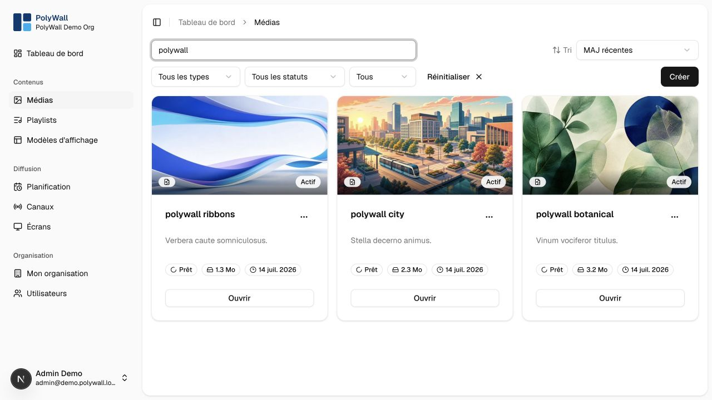

# Media

The media library stores editorial items and tracks their original and generated files.

## Supported formats

| Type         | Typical files                 | Processing                            |
|--------------|-------------------------------|---------------------------------------|
| Image        | JPEG, PNG, WebP, GIF          | metadata and thumbnail                |
| Video        | MP4, WebM, MOV when supported | metadata, duration, and preview frame |
| Document     | PDF                           | one display image per page            |
| Presentation | PPT, PPTX                     | conversion to PDF, then slide images  |

## Import workflow

1. Open **Médias** and choose **Importer**.
2. Select a supported file and enter its metadata.
3. Confirm the upload.
4. Wait until processing changes the item to **Prêt**.

The browser uploads directly to object storage through a short-lived signed URL. The media worker then creates display
variants asynchronously.

## Deleting media

Before deleting an item, check whether it is used by playlists or static template zones. A failed deletion usually
indicates an active relationship that must be removed first.
