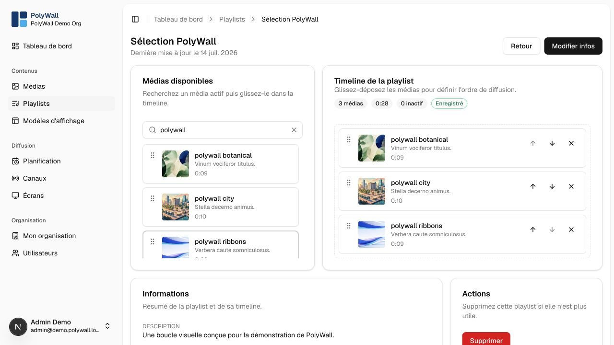

# Playlists

A playlist is an ordered loop of media. The same media item can appear more than once and can be reused across playlists.

## Create and edit

1. Open **Playlists** and select **Créer**.
2. Name the playlist and add a description if useful.
3. Add ready media from the library.
4. Drag items to change their order.
5. Configure an item duration when the media type does not provide one or when an override is needed.
6. Save and use the preview to verify the loop.

Changes affect every schedule that references the playlist. For a live channel, review the channel preview after editing.

