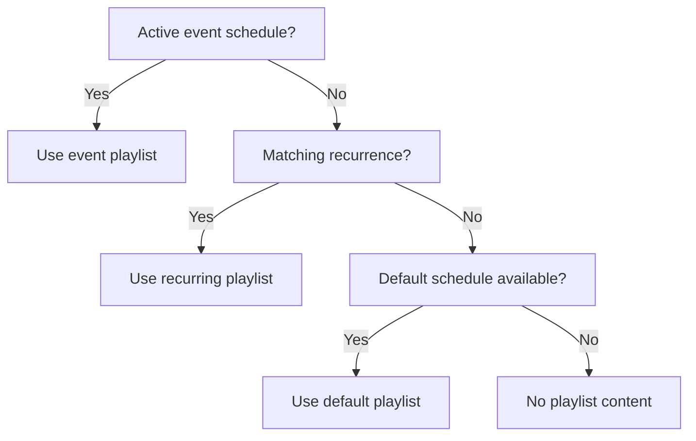
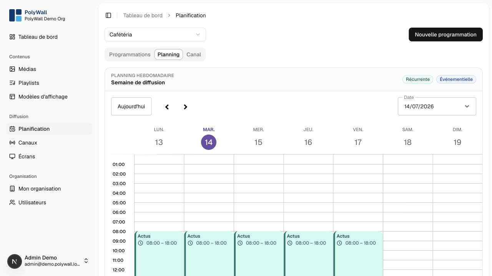

# Schedules

Schedules select the playlist displayed by a channel at a given time. All comparisons use the channel timezone.

## Schedule types and priority

- **Event**: a bounded date and time interval. highest priority.
- **Recurring**: repeats on selected weekdays and times.
- **Default**: fallback when no higher-priority rule matches.

The **Planning** tab projects recurring and event schedules onto a weekly calendar for the selected channel.

## Recommendations

- Create a default schedule for every active channel.
- Keep event windows as narrow as possible.
- Review timezone and daylight-saving behavior.
- Resolve overlapping rules explicitly rather than relying on accidental order.
- Use both calendar and channel previews before publishing a change.
