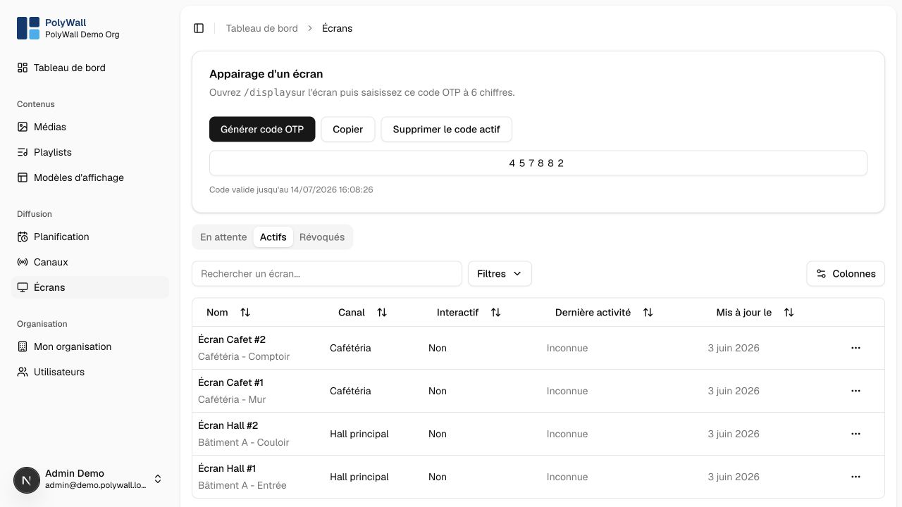
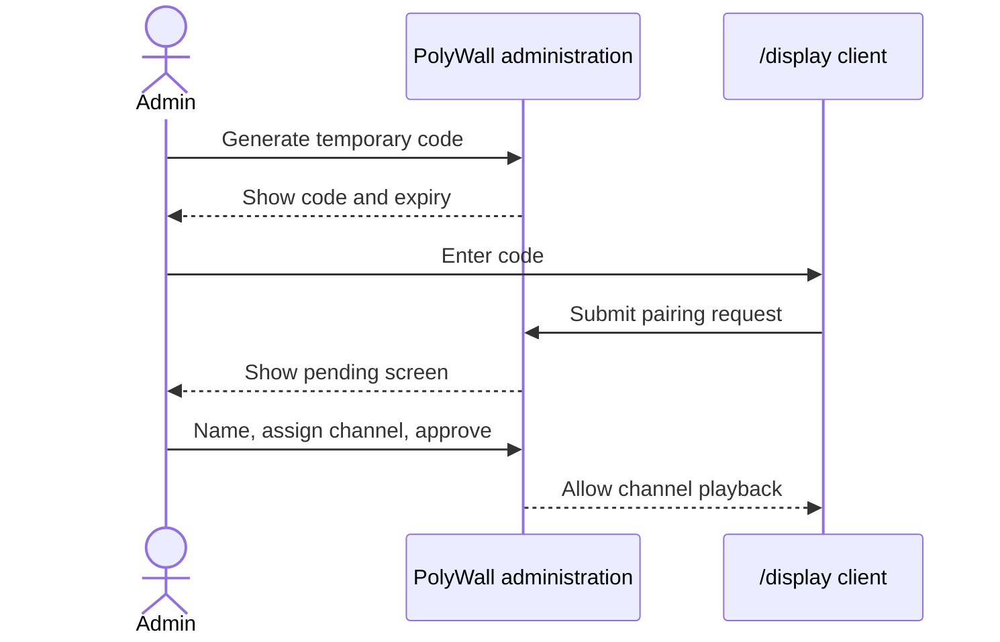
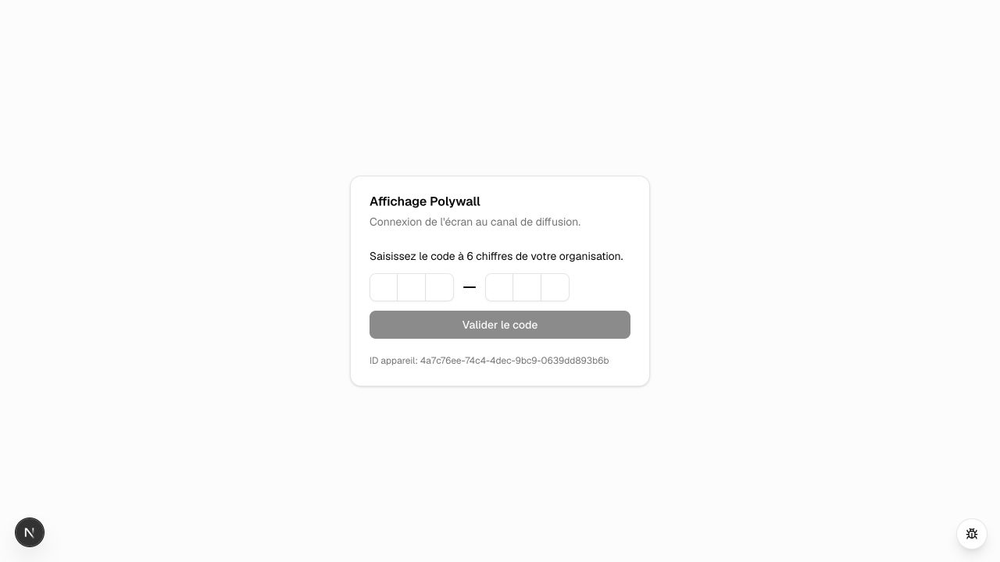

# Screens and pairing

The display client is available at `/display`. Each device creates a local identifier and uses a temporary code issued by an administrator.

## Pair a device

1. In **Écrans**, generate a temporary pairing code.
2. Open the public PolyWall URL followed by `/display` on the device.
3. Enter the code before it expires.
4. Open the pending screen in the administration interface.
5. Set its name, location, and channel, then approve it.

On the device, `/display` presents a dedicated six-digit code entry screen before it is associated with a channel.

Screens can be pending, active, or revoked. `lastSeenAt` helps identify offline devices.

## Interactive screens

An interactive screen can open an approved URL above the signage player. It currently returns to playback only when the user closes the interactive view manually. there is no inactivity timeout.

## Operational advice

Use a dedicated browser profile, automatic launch, full-screen mode, disabled sleep, stable networking, and remote device management. Treat physical access to the device as privileged access.
