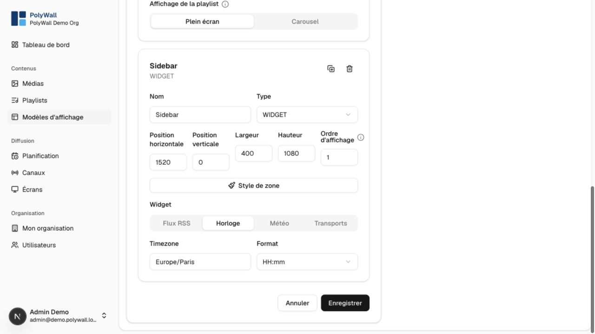

# Widgets

Widgets are dynamic template zones refreshed independently from playlists.

| Widget | Configuration | External dependency |
|---|---|---|
| Clock | format, timezone, style | none |
| Weather | city and display options | weather provider |
| RSS | feed URL and item count | RSS endpoint |
| Transit | provider, stops, routes, destinations | GTFS/GTFS-RT data |

Add a widget zone in the display-template editor, select a widget type, complete its configuration, and preview the channel.

External services can be unavailable or rate-limited. Use conservative refresh intervals and make sure an empty widget does not make the overall layout unusable.

Adding a new widget requires catalog metadata, configuration validation, editor controls, runtime rendering, any server-side data service, seed support, and tests.
